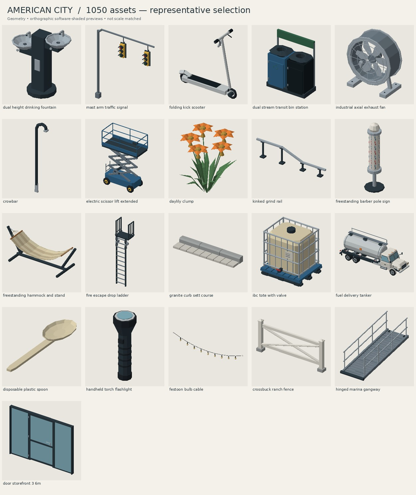

# American City — Low-Poly Items

A collection of 1,000 original low-poly outdoor props for a midsized American city, authored procedurally with Blender-ready geometry. The set covers street furniture, transport, utilities, residential exteriors, construction, parks, storefronts and everyday small objects.



## Files

- **[`city_items.blend`](city_items.blend)** — master Blender file containing all source meshes and the shared material palette.
- **[`exports/`](exports/)** — 1,000 individually named, self-contained GLB files.
- **[`previews/index.html`](previews/index.html)** — searchable local visual catalog. Open after downloading the repository; no installation or network service required.
- **[`previews/`](previews/)** — 20 contact sheets and individual model thumbnails, rendered with software shading from the exported geometry.
- **[`manifest.json`](manifest.json)** — per-model dimensions, geometry counts, material references and export information.
- **[`BATCHES.md`](BATCHES.md)** — the 20 production categories, each with 50 assets.
- **[`tools/`](tools/)** and **[`batches/`](batches/)** — reproducible modeling, export, validation and preview source.

The visual direction follows the user-provided reference; see [`STYLE.md`](STYLE.md).

## Coordinate and material conventions

Units are meters. Blender uses +Z up; GLB uses the standard glTF +Y-up conversion. Each asset is one named mesh with disconnected parts where appropriate, identity transforms and its origin at the bottom center of its axis-aligned bounds. In the source collection, every asset origin is at world **(0, 0, 0)**. Isolate the desired source asset to work on it. The separate **Overview** scene arranges collection instances for browsing; large instances are fitted into the overview grid without changing source dimensions. Each source object is also marked as a Blender asset.

The palette is defined once in `tools/assetlib.py` and uses shared Blender material datablocks. Each GLB embeds the used subset with identical material names and parameters. GLB files are self-contained, so they cannot share a single live material datablock across separate files; remap materials by name during engine import to consolidate them.

Materials use solid colors and metallic/roughness values, without external image textures. Glass is stylized opaque colored glass. Models have no rigging, animation, collisions, LODs or texture UV sets; add those as needed for your engine. Low-poly parts can intersect intentionally, and the meshes are game props rather than watertight 3D-print solids.

## Vertex budgets

| Class | Maximum source and exported vertices |
|---|---:|
| Handheld | 999 |
| Person sized and smaller | 5,000 |
| Car sized and larger | 10,000 |

Both the Blender mesh and GLB vertex stream are checked. GLB counts can be higher because of hard normals and material boundaries. A budget is a ceiling, not a target: simple objects deliberately use fewer vertices.

## Rebuild

Use Python 3.11 and the pinned dependencies in `requirements.txt` (Blender 4.2). The batch source is deterministic, and exports use stable filenames. Build and validation commands check exactly 1,000 assets by default.

```bash
python -m pip install -r requirements.txt
python tools/build.py
python tools/validate.py
python tools/preview.py
```

The preview images show actual exported geometry using orthographic software shading. They are individually framed, so object sizes in the contact sheets are not directly comparable; consult the dimensions in the manifest. These are not engine screenshots.
